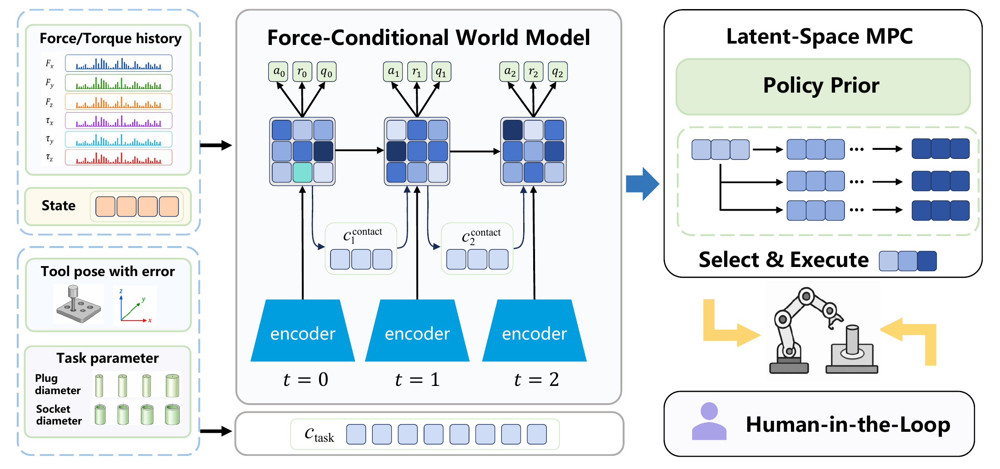

# 基本使用指南

本指南介绍 FACA 模型的使用方式，覆盖安装、输入准备、连续推理、候选评分和权重加载。方法原理见 [Method guide](method.md)，精确张量接口见 [API reference](model_api.md)。

## 模型概览

[](1.pdf)

固定任务描述符提供名义几何上下文，近期状态、腕部 wrench 和已执行动作提供在线接触证据；两者共同更新用于预测和动作评分的 latent。图中还展示了完整系统的 MPC 和可选人工校正采集环节，本仓库提供其中的模型组件与推理工具。[查看矢量 PDF](1.pdf)。

## 1. 安装并运行第一个示例

在仓库根目录、已安装 PyTorch 的 Python 环境中执行：

```bash
python -m pip install -e '.[test]'
python -m pytest -q
python examples/inference.py
```

CPU 验证环境为 Python 3.11、PyTorch 2.7.0、TensorDict 0.11.0。示例使用随机权重和合成输入，无需 Isaac Sim、装配资产或机器人。默认运行 M3，输出类似：

```text
variant=m3 device=cpu mode=prior weights=random inputs=synthetic
step=0 latent=(2, 384) action=(2, 3) reset_rows=[]
  alignment=(2, 2) regime_logits=(2, 3)
...
step=2 latent=(2, 384) action=(2, 3) reset_rows=[0]
```

这表示两个并行样本分别得到 384D latent、3D 动作、2D 对齐预测和三个力状态 logits。第三步演示只重置第一个样本。运行成功验证接口和数据流，不代表随机模型已经学会装配。

可使用以下参数：

```bash
python examples/inference.py --variant m0 --batch-size 1 --steps 2
python examples/inference.py --variant m1 --seed 7
python examples/inference.py --mode candidates --candidates 8
python examples/inference.py --device cuda:0
python -m faca.parameter_audit
```

最后一条命令输出逐模块参数核算。CUDA 示例需要相应 PyTorch/CUDA 环境；CPU 是示例的默认运行设备。

## 2. 构造模型和固定任务描述符

```python
import torch
from faca import FACAConfig, FACA, InferenceSession, task_descriptor, normalize_wrench

device = torch.device('cpu')
model = FACA(FACAConfig(variant='m3')).to(device).eval()
session = InferenceSession(model, batch_size=1)
p = task_descriptor(torch.tensor([0], device=device), 7.986, 0.1, 28.616)
```

FACA 使用五维任务描述符编码装配类型和名义几何参数，定义如下：

```text
p = [类型, log(D / 7.986), c / 3.887, 2c / D, d / 28.616]
```

| 输入 | 含义 | 单位或范围 |
|---|---|---|
| 类型 | peg-in-hole 为 0，hole-onto-peg 为 1 | 0 / 1 |
| D | 被夹持部件的横向宽度代理量 | mm |
| c | 配置中的径向间隙描述符 | mm |
| d | 被夹持部件的名义轴向尺寸 | mm |

`d` 不是目标插入深度，`c` 也不是在线测得的最小表面间隙。描述符在一个 episode 内保持不变。输入类型使用 `[0]` 张量，因此输出 `p.shape == [1,5]`，与单个批量样本匹配；全部传标量会得到 `[5]`，不能直接替代 `[1,5]`。

先把模型移动到目标设备，再创建 `InferenceSession`。观测使用同设备的 float32 张量。切换设备、模型权重或 batch 大小时，应创建新 session。

## 3. 准备当前状态和腕部 wrench

```python
state = torch.zeros(1, 17, device=device)
state[:, 3] = 1.0  # 单位四元数，顺序 wxyz
raw_wrench = torch.zeros(1, 6, device=device)
wrench = normalize_wrench(raw_wrench)
measured = session.observe(state, wrench, p)
```

此处的零输入是占位数据，集成时须换成同一控制时刻的实际测量。

| 输入通道 | 形状 | 内容 |
|---|---|---|
| `state` | `[B,17]` | TCP 相对位置、四元数、线速度、角速度、夹爪宽度、已知名义目标位置 |
| `raw_wrench` | `[B,6]` | 已去皮并转换到 TCP 帧的 Fx/Fy/Fz/Tx/Ty/Tz，单位 N / N m |
| `p` | `[B,5]` | episode 内固定的名义任务描述符 |

位置通道使用米，描述符构造函数的几何输入使用毫米，二者不能混填。参考位置与 TCP 位置必须在相同坐标基下计算差值；具体观测帧和 episode 固定参考误差由环境或机器人适配层提供。

`normalize_wrench` 只做比例缩放：力除以 50、力矩除以 5，不负责去皮、坐标变换、滤波或裁剪。如果环境已经输出归一化 wrench，不要再调用一次。腕部 wrench 用于运行时观测；plug/socket 接触对力用于生成辅助标签，二者属于不同信号。

## 4. 运行预测，并记录实际执行动作

```python
with torch.no_grad():
    action, _ = model.policy(measured.latent, measured.task_context, deterministic=True)
    predicted_next = model.next(measured.latent, action, measured.task_context)
    reward = model.decode(model.reward_logits(measured.latent, action, measured.task_context))
    alignment, force_logits = model.auxiliary(measured)  # 仅 M2/M3

session.commit_action(action)
```

`action` 的每个分量位于 `[-1,1]`，表示模型使用的归一化动作。它需要由适配层映射为笛卡尔位移，不能直接把数值当作毫米或米发送给机器人。若控制器裁剪或替换了动作，应把实际执行的动作转换回模型动作坐标后传给 `commit_action`。

连续执行的调用顺序为：

1. 读取当前状态和 wrench，调用 `observe`。
2. 使用更新后的 measured latent 生成策略先验动作，或对候选动作序列评分。
3. 执行动作，调用 `commit_action` 记录最终执行值。
4. 读取该动作产生的新响应，再次调用 `observe`。

每次 `observe` 后只提交一次动作，再进入下一次观测。session 的最新历史行保存 `(s_t, w_t, a_{t-1})`，即当前观测与产生该观测的上一动作。它自动管理四步历史和上一 measured latent；初始缺失历史补零。这里不需要额外等待四步后才输出第一步动作，四步 replay burn-in 用于训练时的历史重建。

`predicted_next` 和候选轨迹末端 latent 是想象结果，不应写入在线 session。下一控制时刻的 latent 必须由新测量更新。

## 5. 对候选动作序列评分

以下代码接在上文第一次 `observe` 之后使用，展示单个环境的八个候选，每个候选有三步动作：

```python
with torch.no_grad():
    latent = measured.latent[:, None].expand(-1, 8, -1)       # [1,8,384]
    context = measured.task_context[:, None].expand(-1, 8, -1)  # [1,8,64]
    proposals = torch.rand(3, 1, 8, 3, device=device) * 2 - 1
    successors, scores = model.rollout(latent, proposals, context)
    best = scores[0, :, 0].argmax()
    selected_action = proposals[0, 0, best].unsqueeze(0)  # [1,3]
```

`scores` 为 `[1,8,1]`。候选序列的评分由折扣 reward 与 terminal value 组成；后者在策略先验采样动作处，对随机选出的两个 online critics 取平均。执行候选序列的第一步动作，随后用新测量重新编码。该片段是动作选择的替代路径，不能在同一次 `observe` 后把 prior 动作和候选动作各提交一遍。

完整 MPC 的评估配置使用 512 个候选、六轮优化和 64 个 elite；示例仅使用均匀采样候选解释模型评分接口，不包含完整 MPPI。`deterministic=True` 只是便于检查先验均值动作，完整 MPC 评估仍保留策略和 elite 采样，仅关闭最终的额外探索噪声。

## 6. 重置 episode 和切换任务

假设本步已经完成 `commit_action`，下一个 episode 的首帧使用：

```python
new_p = task_descriptor(torch.tensor([1], device=device), 7.986, 0.1, 28.616)
new_measured = session.observe(state, wrench, new_p,
                              reset_mask=torch.tensor([True], device=device))
```

传入新 episode 的真实首帧。reset 会先清空对应样本的历史、上一 latent 和上一动作，再放入新观测。多个环境可以用 `[True, False, ...]` 只重置部分行。任务描述符仅允许在对应 reset 行改变；相同任务的新 episode 也需要 reset，以免继承上一次装配的接触历史。

## 7. 保存和加载模型权重

仓库未提供预训练权重。保存模型权重时，应同时保存网络配置：

```python
from dataclasses import asdict

torch.save({'config': asdict(model.config), 'state_dict': model.state_dict()}, 'model.pt')
payload = torch.load('model.pt', map_location=device, weights_only=True)
restored = FACA(FACAConfig(**payload['config'])).to(device)
restored.load_state_dict(payload['state_dict'], strict=True)
restored.eval()
restored_session = InferenceSession(restored, batch_size=1)
```

该保存格式适用于随机初始化参数和已经学习的权重。加载时保持网络配置一致，并核对坐标帧、wrench 处理和动作尺度。旧版 `WorldModel` 使用不同的输入与辅助头定义，权重不能直接互换，详见[版本兼容性](architecture.md#version-compatibility)。

## 8. 如何理解输出

- `latent`：用于预测和控制的 384D 表征，各维没有预先规定的物理含义。
- `alignment`：被夹持部件在固定部件真实配合帧中的横向位移预测，单位米；与 TCP 位置通道分别定义。
- `force_logits`：三个类别依次为 free、nominal contact、high force；`softmax(-1)` 可转成模型类别概率。
- reward/Q logits：101 个 symlog bins 上的分布输出，需要用 `decode` 转成标量。

辅助输出用于训练时塑造接触表征，不作为基本 MPC 评分项；high force 类别不等于机械卡滞判断。M0 无历史；M1 直接融合历史；M2/M3 有独立接触路径，推理结构相同，区别来自训练监督。

当前模型与历史模型的参数统计、结构差异和 checkpoint 兼容范围，见[参数核对](parameter_counts.md)和[模型结构与兼容性说明](architecture.md)。
